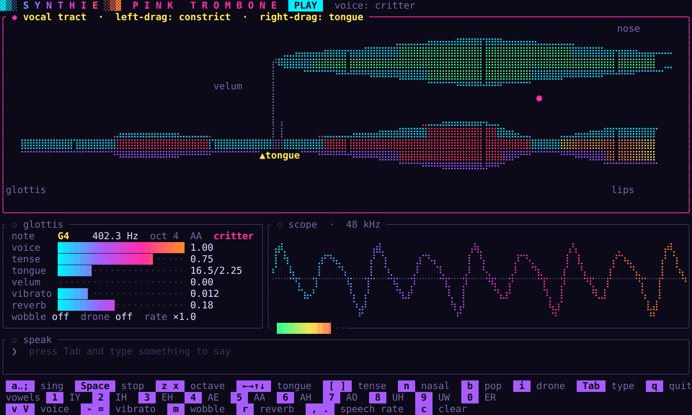
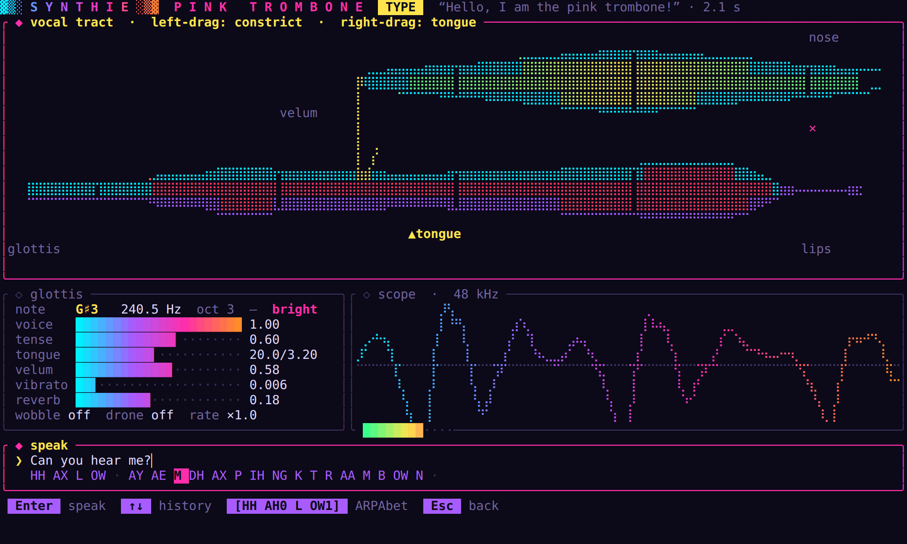

# synthie-trombone

This is [Pink Trombone](https://dood.al/pinktrombone/), Neil Thapen's
physical model of the human voice, rebuilt in Rust: a glottal source pushes
air through a 44-cell waveguide of the vocal tract, you squeeze the tract
somewhere, and out comes something between a vowel and a very confused
trombone. You can play it in your terminal, have it read your text aloud, or
give the characters in your game a voice.

**Play it in your browser: https://sunsided.github.io/synthie-trombone/**





## Trying it out

The browser version runs the same Rust engine through WebAssembly in an
AudioWorklet; `task web:dev` starts it locally with hot reload (it needs
`wasm-pack` and Node with corepack). Everything below is about the
terminal app and the library.

You'll need a Rust toolchain (1.88 or newer for the library) and, on Linux,
the ALSA headers for audio output (`libasound2-dev` on Debian and Ubuntu).
The project uses [go-task](https://taskfile.dev/); `task` on its own lists
everything it can do.

```sh
task run                                   # start the terminal app
task install                               # install it as ~/.cargo/bin/synthie-trombone
task say -- --voice bright "Hello there!"  # speak a line into say.wav
task voices -- "Welcome, traveller!"       # the same line in every voice, in voices/*.wav
```

Without `task`, run `cargo run --release -p synthie-trombone-cli` for the app
and `cargo run --release -p synthie-trombone --example say -- "…"` for a WAV
file. Stick to release builds: the tract model takes 96,000 steps per second
of audio, and a debug build can't keep up with the sound card.

## Playing the terminal app

The app starts in play mode, with the piano on your home row. Hold a key to
sing, change the vowel with the number keys, and work everything else with
the mouse: the tract, the tongue, the velum, and every meter in the panels.

| Key | Action |
|---|---|
| `a w s e d f t g y h u j k o l p ;` | sing, piano layout; `z` / `x` change the octave |
| `Space` or `Esc` | stop singing (and speaking) |
| `1` … `0` | vowels IY IH EH AE AA AH AO UH UW ER |
| arrow keys | move the tongue body |
| `v` / `V` | next / previous voice |
| `'`, `PgUp` / `PgDn`, `Del` | pick a persona dial, turn it, back to neutral |
| `n`, `b`, `i` | nasal (velum), lip pop, drone |
| `[` `]`, `-` `=` | tenseness, vibrato |
| `m`, `r`, `c` | pitch wobble, reverb amount, clear constrictions |
| `\` | switch between the classic and the physical engine |
| `/` | Formant Lock: steer the vowel by F1 and F2 on a vowel chart (arrow keys then nudge F2 / F1) |
| `` ` `` | mimic on or off (start the app with `--mimic`; see below) |
| `F5` | start or stop recording a take (see below) |
| `Tab` | type a line, or paste one; `Enter` speaks it at the current note's pitch |
| `,` `.` | speech rate |
| `q` | quit |

| Mouse | Action |
|---|---|
| left-drag in the mouth or throat | a finger on the wall: the row of the midline shuts the tract (a stop), the row beside it leaves a gap that hisses (a fricative), rows further out only shape it |
| left-drag the tongue handle `◆`, or Shift-drag anywhere | move the tongue body (right-drag also works where the terminal passes it on) |
| click a vowel mark (`i e a o u`) | that vowel |
| click in the nose; drag in the gap under it | open or shut the velum; set how far it hangs open |
| click or drag a meter | tenseness, tongue, velum, vibrato, reverb, loudness (lung pressure, physical engine), and the four persona dials |
| click `[-]` `[+]`, `wobble`, `drone`, `engine` | octave and the toggles |
| click `[/ vowels]` under the scope; left-drag on the vowel chart | Formant Lock on or off; steer the vowel by its formants, or click a vowel mark |

Turning a persona dial or a meter while nothing is sounding plays the
current note for as long as you keep turning (and 0.4 s after), so you
hear what the change does; while a note, the drone, speech or mimic is
sounding, the change is heard in that instead. The tongue handle stays
inside the mouth and follows the voice's size, like the vowel marks.

**Formant Lock** (`/`, or `[/ vowels]` under the scope) lets you find
vowels by how they sound rather than by where the tongue goes. The scope
gives way to a vowel chart, drawn the way phoneticians draw it: F2 across,
high on the left, and F1 down, low at the top. The shaded region is what
this voice's tract can reach (it moves with the persona's size and the
voice's tract length), the IPA letters mark where this voice makes the
English vowels, and `◆` is where the voice is now, with its F1 and F2 in the
panel's title. Press or drag inside the chart and the physical engine's
babble map ([`inverse`](crates/synthie-trombone/src/inverse.rs)) finds the
tongue, lips and narrowing that give those formants; the tract view above
shows them move. A point out of reach is held at the nearest one in reach,
clicking a letter takes that vowel, and the arrow keys nudge F2 (left
raises it, as on the chart) and F1 (up lowers it) by 2 %. Formant Lock
belongs to the physical engine, so turning it on switches to it, and
switching to the classic engine turns it off; turning it off brings the
scope back and leaves the tract as it is.

**Typing and pasting text.** `Tab` opens the text line; `Enter` speaks it,
however many sentences it holds: each gets a pause after it and its own
intonation, and `Esc` stops all of it at once (a second `Esc`, or `Tab`,
goes back to play mode). The line holds up to 4,000 characters and scrolls
sideways to keep the cursor in view. Paste with your terminal's paste key
(`Ctrl+Shift+V` in most, `Cmd+V` on a Mac) or `Shift`+middle-click for the
selection (the app takes mouse clicks itself, so a plain middle-click goes
to the app rather than to the terminal's paste). A paste goes in at the
cursor (from play mode it switches to typing) and is never spoken until you
press `Enter`: line breaks and tabs become spaces, curly quotes, dashes and
`…` become what the speech front end reads, and accents come off letters it
would otherwise skip (`café` is said as `cafe`). The terminal must support
bracketed paste, as all current ones do; in one that does not, the app
still turns line breaks inside a burst of pasted keys into spaces.

| Key (type mode) | Action |
|---|---|
| `←` `→`, `Home` `End` (`Ctrl+A` `Ctrl+E`) | move the cursor |
| `Ctrl+←` `Ctrl+→` (`Alt+B` `Alt+F`) | move by a word |
| `Backspace`, `Delete` | delete a character |
| `Ctrl+W` (`Alt+Backspace`, `Ctrl+Backspace`), `Ctrl+K` | delete the word before the cursor, everything after it |
| `Ctrl+U` | clear the line |
| `↑` `↓` | earlier lines |

Notes stop when you let go of the key in terminals that report key releases
(kitty, WezTerm, foot, Ghostty). In other terminals a note holds until you
press `Space`.

**Recording takes.** `F5` starts recording a take and `F5` again stops it
(in either mode; starting one returns to play mode, so the keys sound);
meanwhile the header shows `● REC take-007 0:03`. A take
is two files in `takes/` under the current directory, or in the directory
given with `--record DIR`, numbered past the highest take already there so
that nothing is overwritten:

- `take-007.wav`: the voice as the engine made it, before the reverb (mono,
  32-bit float, at the sound card's rate);
- `take-007.jsonl`: a log, one JSON object per line. The first holds the
  state of every control at the take's first sample (sound model, voice
  settings, preset and persona, tongue, each constriction, velum,
  tenseness, lung pressure, pitch and voicing, drone, wobble, vibrato,
  reverb, mimic, the vowel shape), each further line one command with the
  sample the audio thread applied it before (`t`; `s` is the same in
  seconds), and the last one the take's length:

  ```json
  {"t":43200,"s":0.9,"cmd":"tongue","diameter":2.05,"index":23.5}
  {"t":52800,"s":1.1,"cmd":"speak","id":2,"prosody":{…},"text":"a big red cat"}
  ```

  Typed speech is logged with its text, and in mimic mode every gesture
  copied from the microphone. If the disk ever falls behind, the end line
  and the status line say how much was lost.

A take starts from silence: when recording starts, speech in progress stops
and the voice is rebuilt from its controls, the same way a replay builds it,
so start recording before you play. Replay a take offline with

```sh
cargo run -p synthie-trombone --example replay --release -- takes/take-007.jsonl \
    --out replay.wav --trace trace.tsv
```

It plays the commands at their samples through the same code as the app
and says whether the result is identical to the take's WAV file (it is,
sample for sample). `--trace` writes a tab-separated row every 5 ms: the
controls' targets, what the tract actually does (its narrowest points, each
constriction, the velum and all 44 diameters), voicing, pitch, level, and
F1–F3 of the tract at that moment.

## Voices

You pick a voice with `v` in the app, `--voice` on the command line, or a
`Preset` in code:

| Preset | Character |
|---|---|
| `deep` | 105 Hz, the model's native tract |
| `bright` | 210 Hz, tract 0.86, livelier intonation |
| `child` | 290 Hz, tract 0.72 |
| `elder` | breathy and slow, with a tremor and a shaky pitch |
| `giant` | 62 Hz, tract 1.4, slow |
| `critter` | 360 Hz, tract 0.6, fast, nasal and very excitable |
| `robot` | monotone, no jitter, pressed |
| `whisper` | breath only, no voicing |

Pitch and vocal tract length vary independently from person to person:
raising only the pitch sounds like the same speaker reaching higher, while a
shorter tract shifts every resonance and sounds like a smaller speaker. The
tract values above are relative to the model's native tract of about 17 cm.
The presets combine both with tenseness, jitter, vibrato, nasality, speaking
rate and how much the intonation moves, and all of these are public fields
of `VoiceSettings`, so your own voice starts from a preset and changes what
you like. With the `serde` feature, the settings can live in your game's
data files.

### Personas and profiles

Describing a voice by its parameters is slow. A `Persona` describes it the
way you would describe a person, with four dials that each move several
parameters together, as they move together in people:

| Dial | From … to | What moves |
|---|---|---|
| `size` | 0.6 (small body) … 1.4 (large) | tract length, and pitch faster than length |
| `effort` | 0 (murmur) … 1 (calling out) | lung pressure, firmer folds, higher and livelier pitch, quicker articulators |
| `breathiness` | 0 (pressed) … 1 (breathy) | how much air escapes past the folds |
| `clarity` | 0 (casual) … 1 (careful) | earlier and faster articulators, longer sounds, firmer closures |

```sh
cargo run --release -p synthie-trombone-cli -- --engine physical --voice bright --size 0.8 --effort 0.7
cargo run --release -p synthie-trombone --example say -- --engine physical --breathiness 0.7 "Hello there."
```

```rust
use synthie_trombone::{Persona, Preset};

let voice = Preset::Bright.settings().with_persona(&Persona {
    size: 0.8,
    effort: 0.7,
    ..Persona::NEUTRAL
});
```

A body of another size is not the same tube scaled: the walls, the side
cavities and the lips do not shrink with it, and unchanged vowel shapes
drift by up to 9 % in the first formant. So each vowel has a shape for
every tract length (a small generated table, `examples/vowel_size.rs`),
which keeps F1 and F2 within 3 % of the native vowel's, scaled, from 0.6
to 1.4. The exception is /u/ (and /w/) in a long tract: it is already as
close as a vowel may be, and its F1 sits up to 6 % high at 1.4.

Underneath sit the sixty-three numbers of `Tuning`, each with a default and
a range a real speaker could plausibly occupy (`Tuning::FIELDS`;
`say --dump-parameters` prints them). The classic engine reads twelve of
them (the lengths of sounds, stress and the gaps); the physical engine
reads the rest as well:

| Group | Fields |
|---|---|
| breath and folds | `lung_pressure`, `adduction_time`, `attack_depth`, `attack_hold`, `modal_gap`, `posterior_gap`, `abducted_area` |
| noise | `jet_efficiency`, `teeth_gain`, `glottal_efficiency`, `hiss_corner` |
| gaps | `fricative_gap`, `approximant_gap`, `nasal_port` |
| larynx in consonants | `abduction_time`, `voiceless_spread`, `voiced_fricative_spread`, `voiced_sibilant_spread`, `voiced_stop_slack`, `cavity_expansion`, `onset_kick`, `kick_time` |
| lengths | `vowel_length`, `diphthong_length`, `stop_length`, `nasal_length`, `fricative_length`, `voiced_fricative_length`, `voiced_sibilant_length`, `approximant_length`, `aspirate_length`, `aspiration`, `stress_stretch`, `vowel_hold` |
| voicing timing | `vot_labial`, `vot_alveolar`, `vot_velar`, `devoicing_lead`, `unstressed_vot`, `fortis_closure`, `prefortis_clip`, `prelenis_stretch` |
| articulators | `lead`, `release_lead`, `articulation_rate`, `body_rate`, `dorsum_rate`, `closing_ratio`, `release_speed`, `closure_overshoot` |
| breath over a phrase | `phrase_onset`, `onset_pressure`, `phrase_decline`, `final_drop` |
| hiss of fricatives | `hiss_floor`, `teeth_corner`, `postalveolar_lips`, `frication_widening`, `frication_ramp` |
| intonation | `accent_size`, `accent_decay`, `declination`, `final_fall` |

A voice with its persona and tuning can be kept as a JSON profile (feature
`profile`); every key is optional and a misspelt one is an error:

```json
{
  "persona": { "size": 0.9, "clarity": 0.7 },
  "pitch": 120.0,
  "tuning": { "lead": 0.035, "fricative_length": 0.11 }
}
```

```sh
cargo run --release -p synthie-trombone --example say -- --engine physical --profile my-voice.json "Hello there."
cargo run --release -p synthie-trombone --example say -- --dump-profile     # the voice in use, as a profile
cargo run --release -p synthie-trombone-cli -- --engine physical --profile my-voice.json
```

A profile read by the `say` example may also carry a `"vowels"` object of
F1, F2 and F3 targets (adult man, Hz) keyed by vowel (`IH`, and `AY<` /
`AY>` for the start and end of a diphthong): `say` solves their shapes
through the babble map when it starts, so other vowel targets can be heard
without regenerating the vowel table. The library's own profiles do not
read it.

```json
{ "engine": "Physical", "vowels": { "IH": [410, 2050, 2700], "AY>": [400, 2100, 2800] } }
```

## The physical engine

Next to Pink Trombone's own model there is a second one, `Engine::Physical`,
that uses the same tract shape and controls but works in real units and
lets the sound come out of the air flow instead of a script:

| | Classic | Physical |
|---|---|---|
| Voice source | a fixed pulse shape | vocal folds as masses on springs, driven by lung pressure through the glottis; pitch from their tension |
| Losses | the same at every frequency | lip radiation, yielding walls and viscous losses, each with its own frequency dependence |
| Side cavities | one lossless nose | two piriform sinuses, two nasal passages with a sinus each |
| Hiss | noise wherever a finger narrows the tract | turbulence where a jet is fast enough, loudest where it strikes the teeth |
| Stop bursts | a scripted pop | pressure builds behind the closure and is released |
| Articulators | constant speed | critically damped, as tissue with inertia |

```sh
cargo run --release -p synthie-trombone-cli -- --engine physical   # `\` switches engines while playing
cargo run --release -p synthie-trombone --example say -- --engine physical "Hello there!"
cargo run --release -p synthie-trombone --example ab                # both engines side by side, in report/
cargo run --release -p synthie-trombone --example probe             # what each engine measures
```

```rust
use synthie_trombone::{Engine, Preset, Talker};

let voice = Preset::Deep.settings().with_engine(Engine::Physical);
let line = Talker::new(44_100.0, voice).bake("Stay a while, and listen.");
```

The physical voice also listens to itself. Each block it reads what its
own air is doing and corrects two things a person corrects by ear: a gap
that is meant to hiss but is shut, choked, or too fine for its stream to
turn turbulent is widened until it does (and the place remembers, so the
next fricative there starts right); and a vowel that starts to hiss, as a
close /u/ does in a loud voice, is opened a little around the place that
hisses and let back when it is quiet. Neither moves anything by more than
0.15 in diameter, and the default voice is left as it was. That is what
lets a persona make the body small or the breath strong without breaking
the consonants, and what lets a finger in the app find a fricative without
landing on its exact width. `examples/hiss.rs` prints the levels over body
size and lung pressure; `Trombone::set_regulation(false)` switches the
correction off to compare.

It is held to published measurements of real voices by tests
(`crates/synthie-trombone/tests/physical_gates.rs` and
`src/phys/tests.rs`); the classic engine is pinned bit for bit by
`tests/classic_golden.rs`, so it is the unchanged baseline to compare
against. A few of the figures:

- Formant bandwidths of 30 to 110 Hz, rising with frequency (classic: 70 to
  1900 Hz), and vowels fitted to Peterson & Barney's F1, F2 and F3.
- The walls resonate against the enclosed air near 190 Hz and give about
  2.7 cm³ per cmH2O, as measured in vivo (Hanna, Smith & Wolfe 2016).
- The piriform sinuses cut a notch near 4.4 kHz (Dang & Honda 1997).
- The folds sing within a cent of the requested note over every preset's
  range, stop below about 3.4 cmH2O of lung pressure, and keep voicing for
  some 40 ms into a /b/ before the mouth fills.
- /s/ and /sh/ come out 15 to 20 dB louder than /f/ and /th/.

It costs more: about 6 times faster than real time on one core at the
native tract length, against 170 for the classic engine. With the default
`Fallback::Auto`, notes outside the folds' range are sung with a
prescribed glottal pulse instead: below it as vocal fry, above it as a
falsetto the folds have no register for. For the native-size voice at
modal tenseness that range is about 56 to 288 Hz, and it scales with the
inverse of the size (the critter voice's is 93 to 488 Hz, so the peaks
of its lively speech, 490 to 520 Hz, are sung by the pulse). Inside the
range the folds sing every note, stalls included; `Fallback::Never`
keeps the pulse out altogether, `GlottalSource::Pulse` uses nothing
else, `Trombone::fold_range` gives the range and `Gauges::sounding`
says which is singing. Body-cover folds under muscle control (Titze &
Story 2002) are implemented and tested but not yet what sets the pitch.

### How it speaks

Speech on the physical engine is made the way a speaker makes it, as far
as the model goes:

- **The voice.** In modal speech the folds close on every cycle, so the
  voice keeps a steady H1–H2 instead of drifting breathy, and the folds
  carry every sentence of the default voices; the pulse only takes notes
  out of their range (above).
- **Voiced and voiceless.** For /p t k f s/ the arytenoids spread the
  glottis behind the folds, slower than the folds themselves move, and the
  voice stops at the moment the mouth actually shuts (the larynx is timed
  from `Trombone::mouth_shut`, not from a script). After a /p t k/ the
  glottis stays open for a voice onset time that grows from the lips to the
  velum, and the voice comes back a little high. In /b d g/ the throat and
  cheeks widen so the air the voice sends into the shut mouth has
  somewhere to go, and the voice carries on through the closure. A vowel
  is shorter before a voiceless consonant that ends its syllable and
  longer before a voiced one, as in English.
- **Stops** build pressure behind the closure and burst by themselves,
  without a click at the release.
- **Two speeds of articulator.** The tongue body and the jaw are heavy and
  slow, so the vowel shape glides from vowel to vowel underneath the
  consonants; the tongue tip, blade and lips are light and quick and make
  the consonants on top of it, and the back of the tongue is in between. A
  consonant is made on the body of the vowel it leads into.
- **Vowels** are the averages for the 45 men of Hillenbrand, Getty, Clark
  & Wheeler (1995), solved into shapes through the babble map, with lip
  protrusion and a jaw; six of them were moved by a few per cent against
  the speech recognizer (`src/vowel_targets.rs` says which and by how
  much). They are held longer than the classic engine's, since the slow
  tongue body needs the time to get there.
- **Phrases.** The lungs build their pressure up over the start of a
  phrase, run down over it and let go over its last vowel, so a sentence
  swells in and dies away. Each stressed vowel gets a pitch accent that
  sinks back, the pitch declines over the phrase, and a statement falls at
  its end.
- **Hiss.** /s/ is a jet on the teeth, brightest of the fricatives; /ʃ/ is
  broader and lower, with rounded but open lips.

Each of these has its numbers in `Tuning` (below) and its gate in
`tests/physical_gates.rs` or `tests/natural_gate.rs`.

The models and numbers come from: Steinecke & Herzel (1995) for the
two-mass folds; Story & Titze (1995) and Titze & Story (2002) for the
body-cover folds and muscle rules, with tissue constants as in Brad
Story's LeTalker 1.22; Titze (1984, 2002) for flow through the glottis;
Hanna, Smith & Wolfe (2016) for the walls; Dang & Honda (1997) and Dang,
Honda & Suzuki (1994) for the piriform sinuses and nose; Flanagan (1972)
for lip radiation; Stevens (1971) and Shadle (1985) for turbulence;
Peterson & Barney (1952) for the vowel targets.

## A voice that listens

Four tools turn sound back into settings. All of them work on the physical
engine.

**The babble map** (`synthie_trombone::inverse`) goes from formants to a
tract shape: `solve(f1, f2, f3, near)` returns the tongue position, lip
rounding and narrowing that give those formants, found from a table of
54,000 shapes the engine was measured at (`examples/babble.rs` regenerates
it). Two hundred random reachable targets land within 1.7 % on F1 and
0.8 % on F2 when measured back through the engine. It covers F1 from about
250 to 710 Hz and F2 from 550 to 2550 Hz at the native tract length, so a
very open /a/ is pulled in a little. Formant Lock in the app is built on
it.

**Mimic** copies a microphone: `--mimic` in the app, or in code a
`listen::Listener` (pitch, three formants, voicing, and how much and how
bright the hiss is, every 5 ms) feeding a `mimic::Mimic`, which picks the
shape through the babble map and a gap for /s/, /sh/ or /f/.

```sh
cargo run --release -p synthie-trombone-cli -- --mimic --voice bright     # wear headphones
cargo run --release -p synthie-trombone-cli -- --mimic --mic pipewire     # choose the input by name
```

In the tests a second voice copies a first from its sound alone: six sung
vowels within 4 % on F1 and F2, the copy's tract in place within 55 ms of
a change. It has only ever heard the synthesizer; a real microphone in a
real room is untested. Formants are hard to read from high voices, where
the harmonics are far apart: above about 200 Hz the first formant reads
10 to 30 % off, and child-sized voices are worse. Pick a voice of about
your own size; vowels the voice cannot reach are pulled to the nearest one
it can.

**Matching a voice** from a recording: `tools/judge/match_voice.py`
measures pitch and its range, the scale of the formants (body size), how
firmly the folds close, breathiness and pace, and writes a profile that
makes the engine measure the same.

```sh
cd tools/judge && uv sync
uv run python match_voice.py someone.wav --out someone.json
cargo run --release -p synthie-trombone-cli -- --engine physical --profile tools/judge/someone.json
```

Recalibrated on this round's engine (the folds now close on every cycle and
the voice is brighter), it re-measures eight hidden engine voices within
1 % on pitch, 0.6 % on formant scale and 0.7 dB on H1-H2; for three of
them it gets there with a tract length 17 to 38 % off the hidden one,
because the formant-scale measure has near-equal answers about 25 % apart.
On six recordings of a human reader it meets those limits on four (on
last round's engine it met them on all six): one is matched 5.7 % low
in pitch, and in another the formant scale is misread as the longest tract
the engine allows. It copies those five things, not the person: accent,
intonation and everything else stay the engine's. Body size is unsteady on
real speech (five recordings of one reader gave tract lengths from 0.78 to
0.97), and very pressed voices are out of the engine's reach.

**A judge and a tuner** (`tools/judge`, see its README): a phoneme
recognizer and Whisper score how much of the engine's speech a machine
understands, and CMA-ES searches the `Tuning` numbers for a better score,
rejecting any candidate that fails the physics gates. The honest
scoreboard, on ten held-out sentences:

| | Phoneme error | Words Whisper gets |
|---|---|---|
| a human reader (other sentences) | 6 % | 96 % |
| eSpeak NG | 16 % | 83 % |
| classic engine | 73 % | 16 % |
| physical engine | 70 % | 25 % |
| physical engine, tuned (`profiles/tuned-r3.json`) | 65 % | 28 % |

So the engines are still far from intelligible to a machine, and tuning
the numbers buys little: the aim was a 20 % cut in phoneme error and the
tuner reached 7.5 %, while Whisper got worse on the sentences it was tuned
on. The tuned profile is kept as a file to listen to, not made the
default. The judge's confusions (vowels heard as "ah", lax vowels heard as
tense, /t/ heard as /d/) point at the vowel targets and the voicing
contrast, which is where the next work lies.

## Making your game talk

Add the library (`synthie-trombone`, in `crates/synthie-trombone`) to your
project, tune a `Talker` once, and turn each line into mono `f32` samples
for whatever plays your audio:

```rust
use synthie_trombone::{Preset, Talker, VoiceSettings, normalize};

let mut shopkeeper = Talker::new(44_100.0, Preset::Elder);
let mut line = shopkeeper.bake("Welcome, traveller!");
normalize(&mut line, 0.9);
// with game-toolkit: audio.play_samples(&line, 44_100)?;

let goblin = VoiceSettings { nasality: 0.4, rate: 1.5, ..Preset::Critter.settings() };
let squeak = Talker::new(44_100.0, goblin).bake("Shiny! Mine!");
```

For live dialogue, `Talker::say` queues text and `Talker::render` fills your
audio buffers as they come. The library never opens an audio device, so it
doesn't compete with kira (or whatever else you use) for the output, and it
builds for `wasm32-unknown-unknown` and without `std` (enable `libm`, plus
`alloc` for speech).

If you'd rather play it as an instrument from your own audio callback,
`Trombone` gives you the voice directly: note on and off, MIDI pitch, glide,
tongue, up to four constrictions, and the velum, with no allocation in the
audio path.

## When the pronunciation is off

Text is looked up in a pronouncing dictionary first: a core of about 2,000
common and irregular words is always built in, and the `dictionary`
feature (on by default, about 22 KB) adds 1,200 less frequent ones. A word
it does not know is taken apart into a known stem and a regular ending
(`-s`, `-ed`, `-ing`, `-ly` ...), and otherwise spelled out by English
letter-to-sound rules (digraphs, the silent *e*, soft *c* and *g*,
unstressed vowels); numbers are spelled out. On the judge's material the
front end now agrees with eSpeak on nearly every word
(`tools/judge/frontend_check.py`). Consonants take the tongue position of
the next vowel, stops get a closure, a burst and a breath, and the pitch
drifts down over a phrase, falls at `.` and rises at `?`. When a word
comes out odd, you can write its phonemes in ARPAbet in square brackets (a
`1` marks the stressed vowel):

```text
[HH AX L OW1], pink trombone!
```

Or give the front end your own words: `speech::phonemize_with(text,
&lexicon)` consults `lexicon` (a lower-case word to ARPAbet such as
`"K AX N UW1"`) in place of the built-in dictionary and spells out
everything else as `phonemize` does; `&|_| None` hears the spelling rules
alone.

## A trombone walks into a synthesizer

I had been building [synthie](https://github.com/sunsided/synth), a
chiptune synthesizer in Rust, and at some point the question came up whether
the trombone could live there too. It turns out somebody already did the
port: the [`pink-trombone`](https://crates.io/crates/pink-trombone) crate
translates [chdh's TypeScript version](https://github.com/chdh/pink-trombone-mod)
to Rust, more or less line by line. I did my own anyway, partly because I
wanted it inside an audio callback (the port is a faithful translation, but
it allocates in the audio path, and a real-time callback is the one place
that can't have that), and partly because once the tract was running I
wanted it to sing notes, speak typed text, and sound like more than one
person.

The vowels were the part I enjoyed most. My first formant probe was a plain
DFT peak search, which happily reported 210 Hz for every vowel I threw at it
(the glottal source tilts the spectrum so hard that the low harmonics win
every time). Switching to LPC gave sensible numbers, and from there a grid
search over tongue position, tongue height and lip rounding fitted each vowel
to Peterson & Barney's 1952 averages for adult male speakers; all nine land
within about 2 % on F1 and F2. The search runs for about four minutes
(`task tune:vowels`), and `task formants` prints what each vowel measures
today.

The screenshots above come from the real UI driven by a real voice;
`task screenshots` renders them again.

## Development

| Task | What it does |
|---|---|
| `task check` | rustfmt, Clippy with warnings as errors, `cargo check`, the `no_std` builds |
| `task test` | all tests |
| `task lint:actions` | actionlint and zizmor over the workflows, same versions as CI |

CI runs the same gates (plus wasm32, docs and the MSRV) on every push and
pull request. Pushing a `v*` tag that matches the workspace version builds
the terminal app for Linux, macOS and Windows and attaches it to a GitHub
release.

## License

EUPL-1.2 (`LICENSE`), like synthie and game-toolkit. Derived from Pink
Trombone, © 2017 Neil Thapen, used under the MIT licence; its notice is in
`NOTICE-pink-trombone`.
